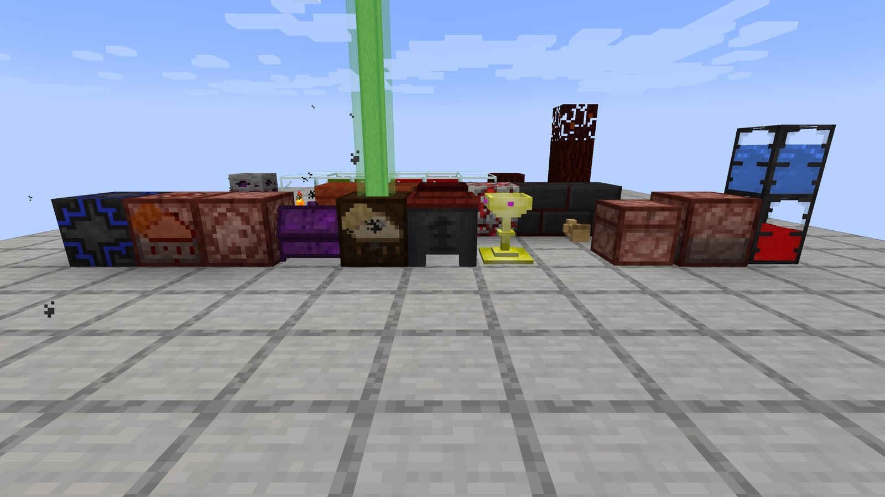
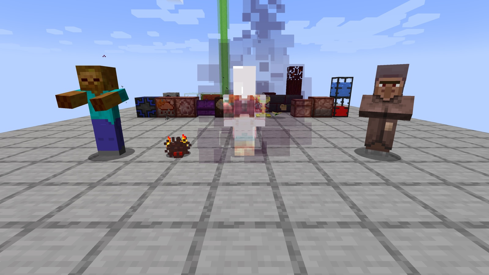
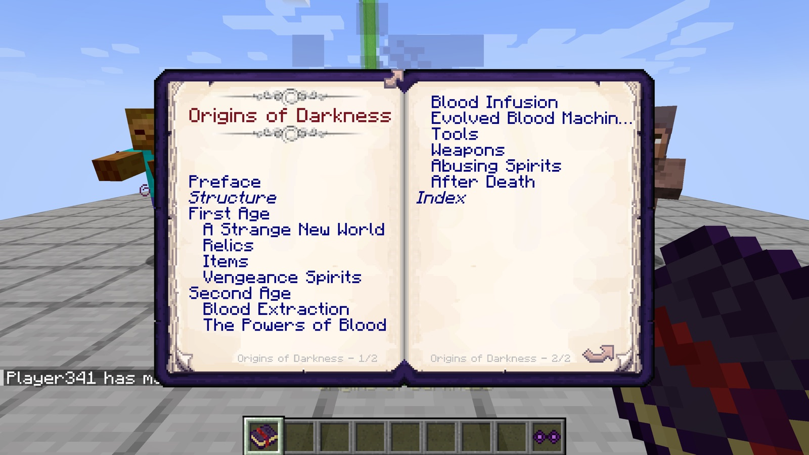
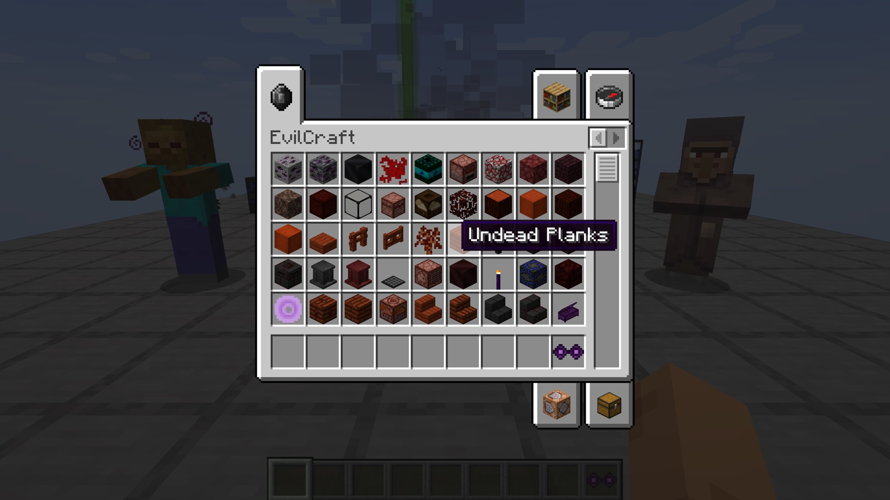
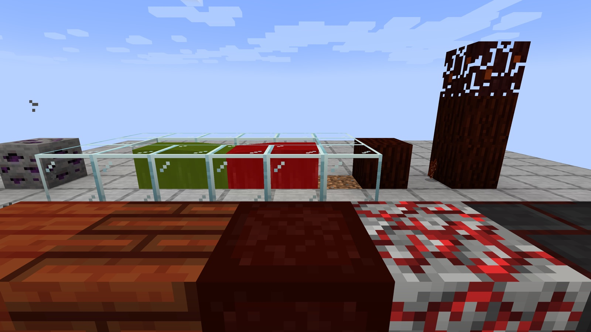
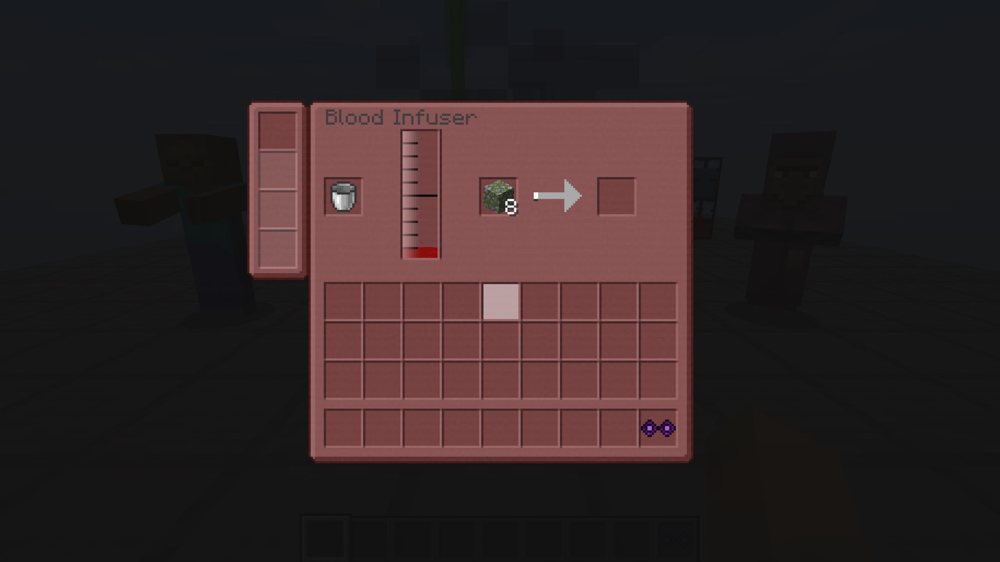

# EvilCraft — Fabric 1.21.1

**Dark magic, blood and vengeful spirits.**

An unofficial port of **[EvilCraft](https://www.curseforge.com/minecraft/mc-mods/evilcraft)** by **rubensworks**
and the CyclopsMC contributors from NeoForge 1.21.1 to **Fabric 1.21.1**, with all of its content.

---

## 🩸 About the mod

EvilCraft brings dark magic to Minecraft: collect blood, harness the power of spirits and the weather, and fight the
creatures of the night.

- **Blood**: a fluid that drops from the mobs you kill, stored in Dark Tanks, Blood Chests and Entangled Chalices
  (linked over any distance), and used by most machines
- **Machines**: the Blood Infuser, the Spirit Furnace, the Spirit Reanimator, the Environmental Accumulator (weather in
  a bottle), the Sanguinary Environmental Accumulator, the Purifier, the Colossal Blood Chest and more
- **Creatures**: Werewolves, Vengeance Spirits (catch them in a Box of Eternal Closure), Poisonous Libelles,
  Netherfish, Controlled Zombies
- **Tools and items**: brooms you build from parts, the Vengeance Ring, the Mace of Distortion, the Necromancer's Staff,
  the Kineticator, Weather Containers, Blood Extractors, Lightning Grenades, the Broom of Flight, ...
- **The world**: Dark Ore, undead trees, blood and poison fluids, Gem Stone Torches, the Spirit Portal and the
  Gemstone of Doom
- **Origins of Darkness**: the in-game book that explains it all, with its own rewards
- **Languages**: English and the translations of the original (Russian, Brazilian Portuguese, Spanish, Chinese and
  more, in various stages)

## 📸 Screenshots

  
  
  
  
  
  

## 📦 Installation

1. Install **Fabric Loader 0.16.14** or newer for Minecraft **1.21.1**.
2. Put into `mods`:
   - `evilcraft-1.21.1-fabric-<version>.jar` from the [releases](../../releases);
   - **[Fabric API](https://modrinth.com/mod/fabric-api)** 0.116.17 or newer;
   - **[Cyclops Core](https://modrinth.com/mod/cyclops-core)** for **Fabric** 1.30.0 or newer;
   - **[Forge Config API Port](https://modrinth.com/mod/forge-config-api-port)** 21.1.6 or newer (the settings).

Required on the client and the server. Settings: `config/evilcraft-common.toml`, `config/evilcraft-client.toml`.

## 🔧 Notes on the port

- Content, recipes, loot and numbers are those of the original (NeoForge 1.21.1, branch `master-1.21-lts`).
- Fluids work with Fabric's transfer API: Dark Tanks, the Blood Infuser and the other blood machines connect to the
  pipes and tanks of other Fabric mods.
- Not ported (yet): the integrations with JEI and other mods, the original's GameTests.

## ✅ Tested

- A client test scene (Fabric Loader 0.16.14, Fabric API 0.116.17, 22 checks): world creation, the blocks, fluids,
  machines and mobs of the mod on screen, the creative tab, the Blood Infuser screen, the Origins of Darkness book;
  fluid transfer through Fabric's API (insert, extract, aborted transactions, buckets and tank items), tanks synced to
  the client and saved, Blood Infuser processing, recipes with Fabric's ingredients and load conditions, world
  generation of Dark Ore, the dungeon loot of the mod.
- The release jar on a production (intermediary-mapped) Fabric server, and the same scene on a production client
  (22 of 22 checks).

## ❤️ Credits

- **EvilCraft** — made by **rubensworks** (kroeser) and the
  [CyclopsMC contributors](https://github.com/CyclopsMC/EvilCraft/graphs/contributors) ·
  [CurseForge](https://www.curseforge.com/minecraft/mc-mods/evilcraft) ·
  [source](https://github.com/CyclopsMC/EvilCraft). All the content, art, texts and ideas are theirs; translations of
  the original by its Crowdin translators.
- **Port** to Fabric 1.21.1 — [Vladeezyy](https://github.com/Vladeezyy).
- Bugs of **this port**: [issues](../../issues). Please don't report port bugs to the original authors.

### License

The port is licensed under the **GNU LGPL 3.0 only** ([LICENSE](LICENSE), with the GPL 3.0 it refers to in
[licenses/COPYING](licenses/COPYING)). Copyright (c) 2026 Vladeezyy for the port.
The original EvilCraft declares the **MIT** license ([licenses/LICENSE-MIT](licenses/LICENSE-MIT)); its README states
that its code and images are under **Creative Commons Attribution 4.0**. The textures, models, sounds and texts of the
original stay under CC BY 4.0, credited to their authors ([licenses/LICENSE-ORIGINAL.md](licenses/LICENSE-ORIGINAL.md)).
Please download the mod only from the official pages.

---

<b>🇷🇺 Описание на русском</b>

 

**Тёмная магия, кровь и мстительные духи.**

Неофициальный порт мода **[EvilCraft](https://www.curseforge.com/minecraft/mc-mods/evilcraft)** от **rubensworks**
и участников CyclopsMC с NeoForge 1.21.1 на **Fabric 1.21.1** — со всем содержимым.

<b>🩸 О моде</b>

EvilCraft приносит в Minecraft тёмную магию: собирайте кровь, подчиняйте силу духов и погоды и сражайтесь с
созданиями ночи.

- **Кровь** — жидкость, которая выпадает из убитых мобов; хранится в Тёмных резервуарах, Кровавых сундуках и
  Запутанных чашах (связанных на любом расстоянии), нужна почти всем машинам
- **Машины**: Кровавый инфузор, Духовная печь, Реаниматор духов, Накопитель окружения (погода в бутылке),
  Кровавый накопитель окружения, Очиститель, Колоссальный кровавый сундук и другие
- **Существа**: оборотни, Духи мщения (ловятся Ящиком вечного заточения), Ядовитые стрекозы, Незерская чешуйница,
  Подчинённые зомби
- **Инструменты и предметы**: мётлы из деталей, Кольцо мщения, Булава искажения, Посох некроманта, Кинетикатор,
  Контейнеры погоды, Экстракторы крови, Молниевые гранаты, ...
- **Мир**: тёмная руда, мёртвые деревья, жидкости крови и яда, Факелы из самоцветов, Портал духов и Самоцвет рока
- **Origins of Darkness** — книга в игре, которая всё объясняет и даёт награды
- **Языки**: английский и переводы оригинала (русский, бразильский португальский, испанский, китайский и другие, в
  разной степени готовности)

<b>📦 Установка</b>

1. Установите **Fabric Loader 0.16.14** или новее для Minecraft **1.21.1**.
2. Положите в `mods`:
   - `evilcraft-1.21.1-fabric-<версия>.jar` из [релизов](../../releases);
   - **[Fabric API](https://modrinth.com/mod/fabric-api)** 0.116.17 или новее;
   - **[Cyclops Core](https://modrinth.com/mod/cyclops-core)** для **Fabric** 1.30.0 или новее;
   - **[Forge Config API Port](https://modrinth.com/mod/forge-config-api-port)** 21.1.6 или новее (настройки).

Нужен и на клиенте, и на сервере. Настройки: `config/evilcraft-common.toml`, `config/evilcraft-client.toml`.

<b>🔧 О порте</b>

- Содержимое, рецепты, добыча и числа — как в оригинале (NeoForge 1.21.1, ветка `master-1.21-lts`).
- Жидкости работают через transfer API Fabric: Тёмные резервуары, Кровавый инфузор и другие машины соединяются с
  трубами и баками других Fabric-модов.
- Пока не перенесено: интеграции с JEI и другими модами, GameTest'ы оригинала.

<b>❤️ Авторы и лицензия</b>

- **EvilCraft** — автор **rubensworks** (kroeser) и
  [участники CyclopsMC](https://github.com/CyclopsMC/EvilCraft/graphs/contributors) ·
  [CurseForge](https://www.curseforge.com/minecraft/mc-mods/evilcraft) ·
  [исходники](https://github.com/CyclopsMC/EvilCraft). Всё содержимое, графика, тексты и идеи — их; переводы
  оригинала — его переводчиков на Crowdin.
- **Порт** на Fabric 1.21.1 — [Vladeezyy](https://github.com/Vladeezyy).
- Ошибки **порта**: [issues](../../issues). Пожалуйста, не сообщайте об ошибках порта авторам оригинала.

Порт распространяется под **GNU LGPL 3.0 only** ([LICENSE](LICENSE), GPL 3.0 — в [licenses/COPYING](licenses/COPYING)).
Оригинал объявляет лицензию **MIT** ([licenses/LICENSE-MIT](licenses/LICENSE-MIT)), а в его README сказано, что код и
изображения — под **Creative Commons Attribution 4.0**. Текстуры, модели, звуки и тексты оригинала остаются под CC BY
4.0 с указанием авторов ([licenses/LICENSE-ORIGINAL.md](licenses/LICENSE-ORIGINAL.md)).

